# SignalFoundry

**Cyber risk quantification from the incidents your team already closed.**

SignalFoundry connects to your SIEM or security tools, reads the incidents your analysts resolved, and answers the question a board actually asks: *how much does our detection and response reduce the chance and cost of a loss?* The answer is anchored to published loss data for organisations of your size, so it cannot be inflated by alert volume.

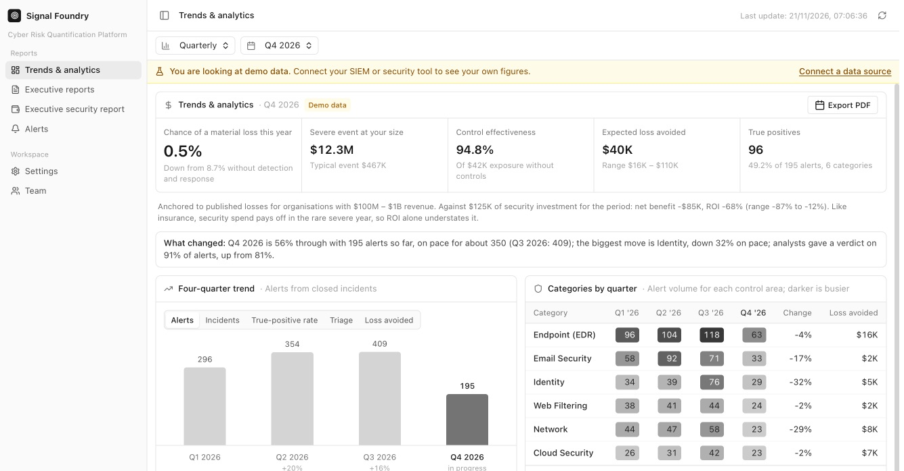

| | |
|---|---|
| **Risk first** | Chance of a material loss this year, with and without your controls |
| **Dollars second** | Expected loss avoided, with a plausible range, set against what you spend |
| **Evidence shown** | Every figure traces back to incidents, analyst verdicts and a published source |
| **Eight integrations** | Defender XDR, Sentinel, Splunk ES, QRadar, Elastic, CrowdStrike, SentinelOne, Cortex XDR |
| **Built for teams** | Five roles, invitations, a sign-up policy and an audit log |

## Contents

- [Walkthrough](#walkthrough)
- [Quick start](#quick-start)
- [Data sources](#data-sources)
- [Team, roles and access](#team-roles-and-access)
- [How the figures are calculated](#how-the-figures-are-calculated)
- [Demo data](#demo-data)
- [Architecture](#architecture)
- [API](#api)
- [Configuration](#configuration)
- [Testing](#testing)
- [Known limits](#known-limits)

---

## Walkthrough

Every screenshot below is from the running app on its built-in demo data. Numbers in red circles match the notes under each picture.

### 1. Trends & analytics

The home screen. It leads with risk, then dollars, then shows how the last four quarters compare.

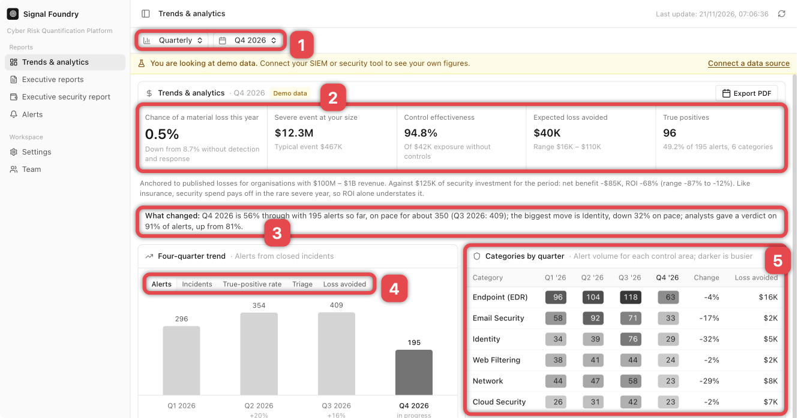

1. **Period.** Switch between a quarter and a full year, and pick the quarter. Every screen follows this choice.
2. **Headline figures.** The chance of a material loss this year with your controls (and what it would be without them), the size of a severe event for an organisation your size, your control effectiveness, and the expected loss avoided with its range.
3. **What changed.** One sentence comparing this quarter with the last. A quarter still in progress is compared on pace, not on raw counts, so it never looks like a collapse.
4. **Metric switch.** The four-quarter chart can show alerts, counted incidents, true-positive rate, triage coverage or loss avoided.
5. **Categories by quarter.** A heat map of alert volume for the six control areas. Darker cells are busier, so a phishing wave or an identity campaign stands out at a glance.

Further down the same screen:

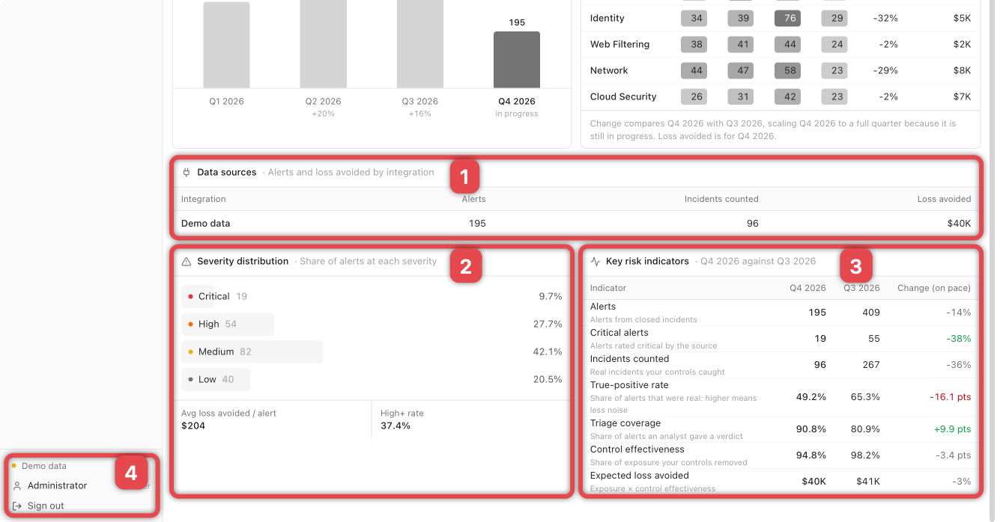

1. **Data sources.** Alerts, counted incidents and loss avoided for each connected integration.
2. **Severity distribution.** The share of alerts at each severity.
3. **Key risk indicators.** Each indicator for this quarter and the last, with the change. Green and red mark changes that are clearly better or worse; counts with no good direction stay grey.
4. **Data status.** The sidebar always says where the figures come from: demo data, a live source and when it last synced, or a source that is failing.

### 2. Executive reports

A one-page summary for people who will not read a dashboard.

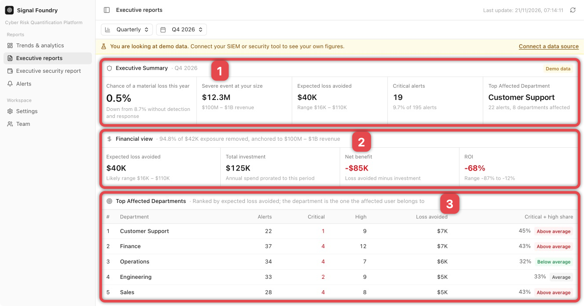

1. **Executive summary.** The same risk and dollar headline, plus critical alerts and the most affected department.
2. **Financial view.** Loss avoided against investment, net benefit and ROI with its range. ROI is deliberately not the headline: security spend works like insurance and pays off in the rare severe year.
3. **Departments.** Ranked by expected loss avoided, with each department's share of critical and high alerts compared with the organisation's average.

Both report screens have an **Export PDF** button that prints the report with the figures and the basis for them.

### 3. Alerts

Every alert behind the figures, so nothing on the dashboard has to be taken on trust.

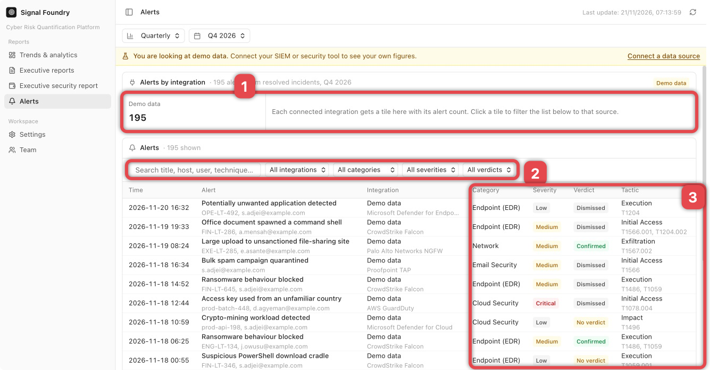

1. **Tiles by integration.** One per connected source. Click a tile to filter the list to it.
2. **Search and filters.** By title, host, user or technique, and by integration, category, severity and analyst verdict.
3. **What was decided.** Category, severity, the analyst's verdict (confirmed, dismissed or none) and the MITRE ATT&CK tactic that sets how serious the incident was.

### 4. Settings: your organisation and spend

Two inputs drive every dollar figure. The panel on the right shows the effect of a change before you save it.

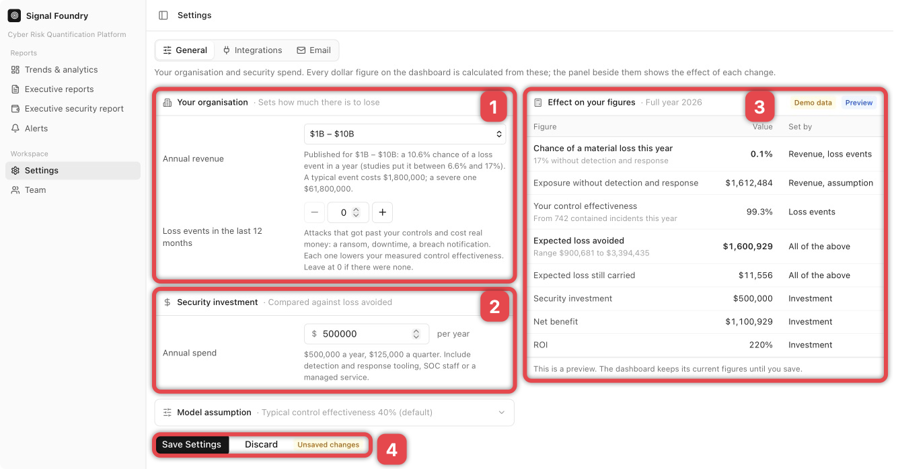

1. **Your organisation.** Annual revenue selects the published loss data to anchor to. Loss events you actually suffered lower your measured control effectiveness.
2. **Security investment.** Annual spend on detection and response, compared against loss avoided.
3. **Effect on your figures.** A live preview of the year's figures for the values on screen, and which input sets each one.
4. **Save or discard.** Nothing changes on the dashboard until you save.

A collapsed **Model assumption** section holds the one judgment-based number in the model, with the evidence for its default.

### 5. Integrations

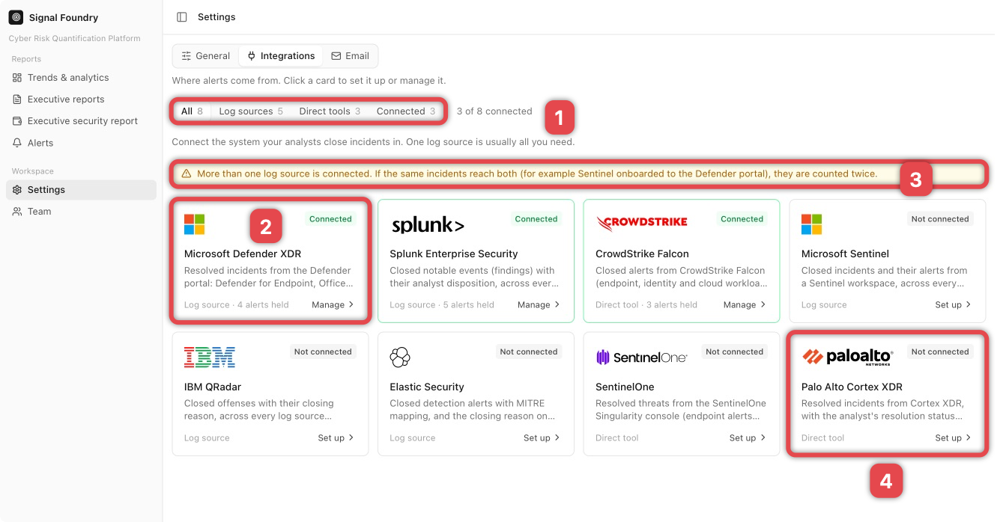

1. **Filter.** All, log sources, direct tools, or connected only.
2. **A connected source.** Shows how many alerts it holds; click to manage it.
3. **Double-counting warning.** Shown when more than one log source is connected, because the same incident may arrive twice.
4. **A source to set up.** Click any card to open its form.

Each card opens a form with the vendor's setup steps beside the fields:

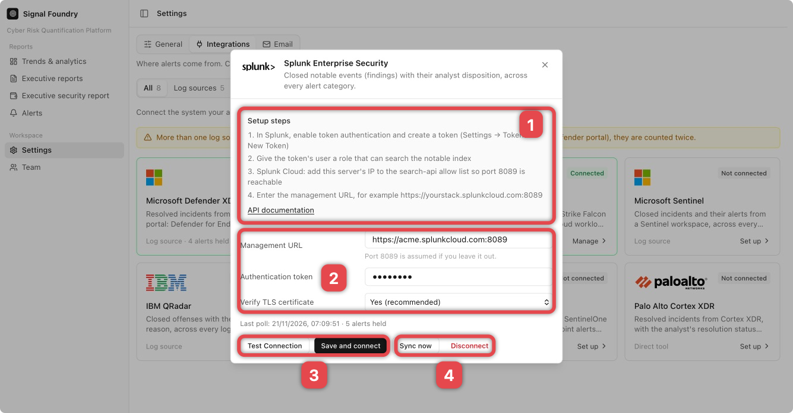

1. **Setup steps.** What to create on the vendor's side, with a link to its API documentation.
2. **Credentials.** Secrets are stored on the server and shown masked afterwards.
3. **Test, then save.** *Test Connection* checks the credentials and reports the vendor's own error if they are rejected. *Save and connect* starts pulling the last 90 days, then polls every 15 minutes.
4. **Sync now.** Pulls at once. *Disconnect* asks for confirmation, because it removes that source's alerts.

### 6. Team, roles and access

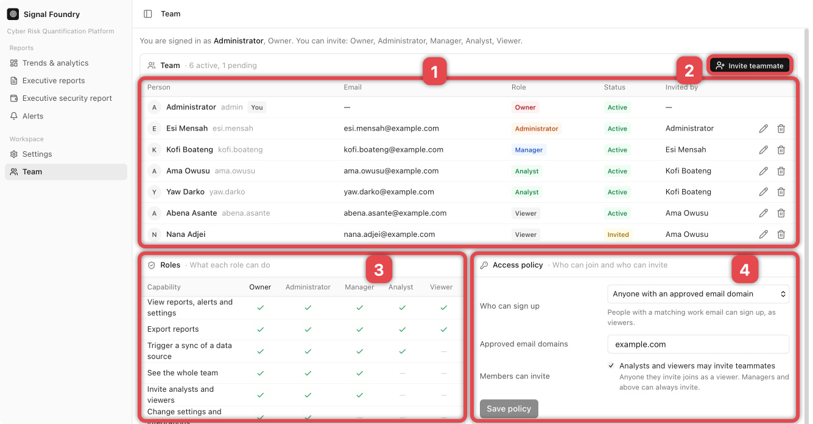

1. **The team.** Who has access, their role, whether they have accepted their invitation, and who invited them.
2. **Invite teammate.** Available to everyone who is allowed to invite; the roles they can grant depend on their own.
3. **Roles.** What each of the five roles can do.
4. **Access policy.** Who may sign themselves up, and whether analysts and viewers may invite.

Inviting someone takes an email and a role:

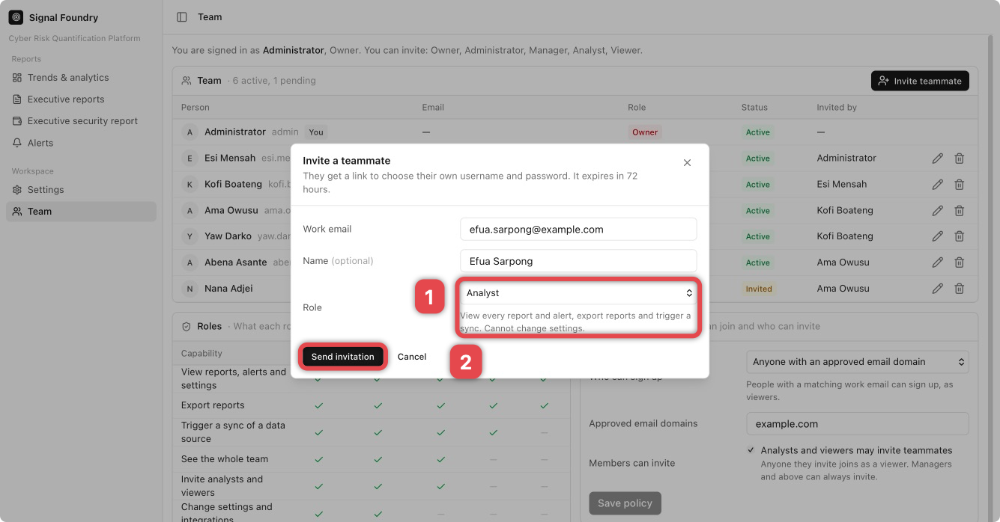

1. **Role.** Only the roles you are allowed to grant are listed, each with a plain description.
2. **Send.** They receive a link (by email if SMTP is set up, otherwise shown for you to copy) to choose their own username and password. It expires in 72 hours.

Administrators and owners also get an audit log:

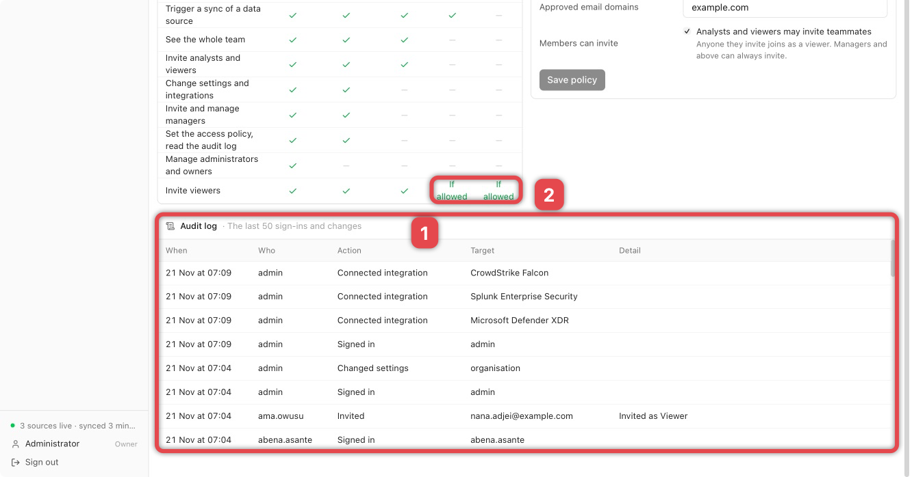

1. **Audit log.** Sign-ins, failed sign-ins, invitations, role changes, removals, settings changes and integration changes, with who did each one.
2. **"If allowed".** Analysts and viewers can invite viewers only while the access policy permits it.

The login page follows the access policy:

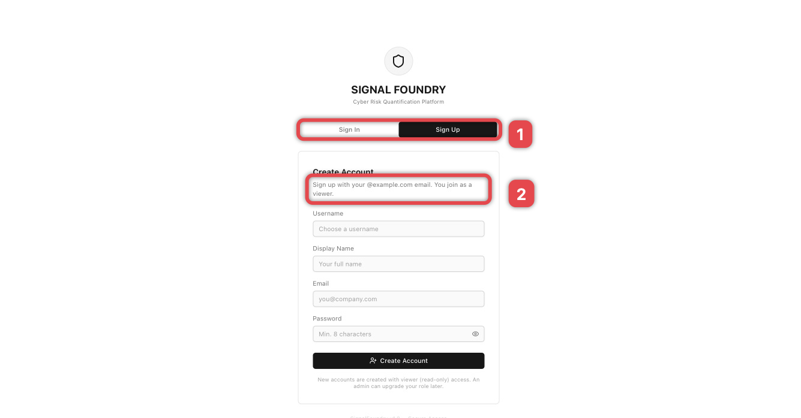

1. **Sign Up** appears only when the policy allows it. An invitation-only workspace shows a short note instead.
2. With a domain policy, the form says which email domains are accepted.

---

## Quick start

Requires **Node.js 22.13 or later**.

```bash
git clone https://github.com/FletcherFrimpong/Signal-Foundry.git
cd Signal-Foundry
npm install
npm run dev
```

Open <http://localhost:3002>.

1. **Sign in.** On first start an owner account named `admin` is created with a random password, written to `.data/initial-credentials.txt`. Sign in, then delete that file.
2. **Describe your organisation.** Settings → General: choose your revenue band and enter your annual security spend.
3. **Connect a data source.** Settings → Integrations: open a card, follow its setup steps, test, then save. The demo data is replaced by your own incidents.
4. **Invite your team.** Team → Invite teammate.

For production, set `AUTH_SECRET` (see [Configuration](#configuration)) and serve the app over HTTPS.

---

## Data sources

Each source pulls closed or resolved alerts with the analyst's verdict where the product records one. The first sync covers the last 90 days; after that it polls every 15 minutes and remembers where it got to.

| Source | Kind | What it pulls | Verdict comes from | Credentials |
|---|---|---|---|---|
| **Microsoft Defender XDR** | Log source | Resolved incidents and alerts (Microsoft Graph security API) | Incident classification | App registration with `SecurityIncident.Read.All`, `SecurityAlert.Read.All` |
| **Microsoft Sentinel** | Log source | Closed incidents and alerts from a workspace (Azure Resource Manager API) | Incident classification | App registration with the Microsoft Sentinel Reader role |
| **Splunk Enterprise Security** | Log source | Closed notable events (findings) | Disposition | Management URL (port 8089) and an authentication token |
| **IBM QRadar** | Log source | Closed offenses | Closing reason text | Console URL and an authorized service token |
| **Elastic Security** | Log source | Closed detection alerts | Closing reason (Stack 9.2+) | Kibana URL and an API key |
| **CrowdStrike Falcon** | Direct tool | Closed alerts | Resolution | API client with `Alerts: Read` |
| **SentinelOne** | Direct tool | Resolved threats | Analyst verdict | Console URL and a service-user API token |
| **Palo Alto Cortex XDR** | Direct tool | Resolved incidents | Resolution status | API URL, key ID and key |

Things to know:

- **Connect one log source.** A SIEM already aggregates your tools. Add a direct tool only if it does *not* feed that SIEM, or its incidents are counted twice.
- **Six categories.** Every alert is sorted into Endpoint, Email, Network, Web, Cloud or Identity, using the most specific evidence available (the product that raised it, then the log source, then the title).
- **Departments** come from the affected user's directory record. Only Defender XDR supplies them (it needs `User.Read.All` and `Device.Read.All`); other sources show "Unattributed".
- **QRadar** has no true/false-positive field, so an offense counts only if its closing reason says it was real.
- **Elastic** records a verdict only as the closing reason, from Stack 9.2. Earlier versions are weighted by MITRE mapping alone.
- **Sovereign clouds.** Set `SF_MS_LOGIN_URL`, `SF_GRAPH_URL` and `SF_ARM_URL` for Microsoft national clouds, and `SF_CROWDSTRIKE_URL` for a CrowdStrike cloud that is not listed.

**What happens to the demo data?** It is never stored. Saving your first integration clears it, and a banner says the source is connecting until the first sync lands. If a source fails, the banner shows the vendor's error and says the figures may be out of date. Disconnecting the last source brings the demo data back.

To add a connector, implement `ConnectorDefinition` in `src/lib/connectors/` and list it in `registry.ts`.

---

## Team, roles and access

### Roles

Each role has every permission of the roles below it.

| Capability | Owner | Administrator | Manager | Analyst | Viewer |
|---|:-:|:-:|:-:|:-:|:-:|
| View reports, alerts and settings; export reports | ✓ | ✓ | ✓ | ✓ | ✓ |
| Trigger a sync of a data source | ✓ | ✓ | ✓ | ✓ | |
| See the whole team | ✓ | ✓ | ✓ | | |
| Invite analysts and viewers | ✓ | ✓ | ✓ | | |
| Change settings and integrations | ✓ | ✓ | | | |
| Invite and manage managers | ✓ | ✓ | | | |
| Set the access policy, read the audit log | ✓ | ✓ | | | |
| Manage administrators and owners | ✓ | | | | |
| Invite viewers | ✓ | ✓ | ✓ | if allowed | if allowed |

### Rules the server enforces

- **Nobody grants a role at or above their own**, except an owner. An administrator cannot create another administrator.
- **Nobody manages someone at or above their own role**, except an owner.
- **A workspace always keeps at least one owner.** The last owner cannot be demoted or removed.
- **You cannot change your own role or remove yourself.**
- **Analysts and viewers see only themselves and the people they invited.** They can withdraw their own pending invitations.
- **Role changes and removals take effect at once.** Every request re-checks the user's current role, so a removed user's session stops working immediately.

These rules live in `src/lib/auth/rbac.ts` and are checked in the API, not only hidden in the interface.

### How new people join

| Route | Result |
|---|---|
| **Invitation** | The inviter picks a role they are allowed to grant. The invitee sets their own username and password from a link that expires in 72 hours. |
| **Sign-up** | Always creates a **viewer**. Whether it is offered at all is set by the access policy. |
| **First start** | The first account is the workspace **owner**. |

### Access policy

Set on the Team screen by an administrator or owner.

| Who can sign up | Effect |
|---|---|
| **Invitation only** (default) | No self sign-up. The form is hidden. |
| **Approved email domain** | Anyone with a matching work email can sign up as a viewer. |
| **Anyone who can reach the site** | Open sign-up as a viewer. Use only on a private network: viewers can read every report. |

A second switch controls whether analysts and viewers may invite teammates (as viewers). Managers and above can always invite.

### Audit log

Sign-ins, failed sign-ins, sign-ups, invitations, accepted and withdrawn invitations, role changes, password resets, removals, access-policy changes, settings changes, and integrations connected or disconnected. Each entry records who, when and what. Secrets are never written to it.

### Sessions

JWT in an HttpOnly cookie, eight-hour expiry, bcrypt password hashes, rate limits on sign-in and sign-up.

---

## How the figures are calculated

The model lives in `src/lib/risk-model.ts`; the published data in `src/lib/anchor-data.ts`.

The dollar figure is built top-down, so it can never exceed what organisations of your size actually stand to lose:

```
exposure      = peer loss frequency / (1 - typical control effectiveness) x expected loss per event
loss avoided  = exposure x YOUR control effectiveness
ROI           = (loss avoided - investment for the period) / investment x 100
```

**1. Peer loss frequency and size (published).** From the Cyentia Institute's Information Risk Insights Study, by revenue band: the yearly probability of a loss event (IRIS 2022) and the median and 95th-percentile loss (IRIS 2025). The expected loss per event is capped at the 95th percentile so one extreme tail value cannot dominate.

**2. Typical control effectiveness (assumed, 40%).** Published losses are the events that got past typical controls, so dividing by `1 - 0.4` gives the exposure with no detection and response at all. No study measures this directly; surveys put attacks stopped before damage at roughly 21–44%. It is the model's most influential number, it is adjustable between 20% and 80% in Settings, and the interface says plainly that its evidence is thin.

**3. Your control effectiveness (from your incidents).** Alerts are grouped into incidents. Each contained incident gets a weight:

```
weight = P(real) x stage weight

P(real):       analyst said true positive -> 1;  false positive or benign -> 0
               no verdict: needs a known MITRE technique and tool confidence >= 70%
               (or confidence >= 90% without one), then weighted by that confidence
stage weight:  by the furthest MITRE ATT&CK tactic seen, from 0.02 (reconnaissance)
               to 0.75 (impact); falls back to severity when there is no tactic
```

```
effectiveness = (0.4 x 2 + sum of weights) / (2 + sum of weights + loss events you suffered)
```

With no incident data this equals the typical 40%. Contained incidents move it toward 100%; loss events you actually suffered pull it down.

**4. Range.** 5,000 seeded trials over the published frequency bounds and both effectiveness figures give a 5th–95th percentile range. It is a range for the expected value, not a forecast of any single year.

**Why loss avoided barely moves between quarters.** It follows your size and how reliably incidents are caught, not alert volume. A busy quarter does not make the number bigger. That is deliberate, and it is why the trend view offers alert volume, true-positive rate and triage coverage as separate metrics.

**What the figures leave out.** The published data covers publicly known incidents and direct, quantifiable losses, mostly from US organisations, so results err low.

---

## Demo data

Until a source is connected, the app shows a repeatable demo dataset (`src/data/demo-alerts.ts`): four quarters, six categories, eight departments, realistic alert titles and analyst verdicts. The year has a story so the trend views have something to show: a phishing wave in Q2, an identity attack campaign in Q3, and triage coverage that improves every quarter. The same quarter always produces the same alerts.

Demo data is labelled wherever it appears and is never written to the database.

---

## Architecture

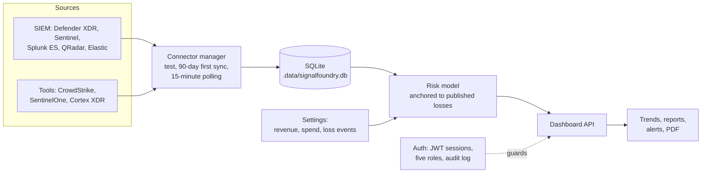

- **Stack.** Next.js 16, React 19, TypeScript, Tailwind CSS 4.
- **Storage.** Alerts and the audit log in a SQLite file using Node's built-in driver. Settings and users in JSON files in `.data/`. Everything in `.data/` is git-ignored.
- **Server-side figures.** The browser never computes a number; every screen reads `/api/dashboard`.

```
src/
├── app/
│   ├── page.tsx                 App shell: sidebar, period controls, screens
│   ├── login/  invite/          Sign in, sign up, accept an invitation
│   └── api/
│       ├── auth/                login, logout, signup, setup, me, invite, accept-invite, users
│       ├── team/policy/         access policy
│       ├── audit/               audit log
│       ├── connectors/          list, save, test, sync
│       ├── dashboard/           every figure the screens show
│       ├── alerts/  metrics/    alert list, cost metrics
│       ├── settings/            organisation, spend, SMTP (+ /preview)
│       └── data-status/         demo, syncing, live or failing
├── components/                  trends-analytics, alerts-browser, integrations,
│                                settings-general, team-page, data-status
├── data/demo-alerts.ts          Repeatable demo dataset
└── lib/
    ├── risk-model.ts            The model
    ├── anchor-data.ts           Published loss data by revenue band
    ├── connectors/              One file per integration + manager + registry
    ├── auth/                    rbac, sessions, password hashing, user store
    ├── audit-log.ts             Audit log
    └── alert-store.ts           SQLite persistence
```

---

## API

All routes require a session unless marked public. Permissions are checked on the server.

| Method | Endpoint | Purpose | Who |
|---|---|---|---|
| POST | `/api/auth/login` | Sign in | Public |
| POST | `/api/auth/logout` | Sign out | Public |
| POST | `/api/auth/signup` | Self sign-up as viewer, if the policy allows | Public |
| GET, POST | `/api/auth/setup` | First-run check; create the owner | Public (POST only while no users exist) |
| GET | `/api/auth/me` | Current user, permissions, roles they may grant | Signed in |
| POST | `/api/auth/invite` | Invite a teammate | Anyone allowed to invite |
| GET, POST | `/api/auth/accept-invite` | Validate a token; set username and password | Public |
| GET | `/api/auth/users` | The team (or your own invitees) | Signed in |
| PUT | `/api/auth/users` | Change details, role or password | Administrator, Owner |
| DELETE | `/api/auth/users?id=` | Remove someone, or withdraw your own invitation | Per the rules above |
| GET, POST | `/api/team/policy` | Read or set the access policy | Read: signed in. Write: Administrator, Owner |
| GET | `/api/audit` | Audit log | Administrator, Owner |
| GET | `/api/dashboard` | All dashboard figures for a period | Viewer and above |
| GET | `/api/alerts` | Alerts with filters | Viewer and above |
| GET | `/api/data-status` | Where the figures come from | Viewer and above |
| GET | `/api/settings` | Settings, secrets masked | Viewer and above |
| POST | `/api/settings` | Save settings | Administrator, Owner |
| POST | `/api/settings/preview` | Figures for unsaved settings | Viewer and above |
| GET | `/api/connectors` | Integrations and their status | Viewer and above |
| POST | `/api/connectors` | Save or disconnect an integration | Administrator, Owner |
| POST | `/api/connectors/test` | Test credentials | Administrator, Owner |
| POST | `/api/connectors/sync` | Pull now | Analyst and above |
| POST | `/api/sentinel/webhook` | Receive pushed incidents | HMAC signature |

**Incident webhook (optional).** To receive Defender XDR or Sentinel incidents as they are resolved instead of waiting for the next poll, set `DEFENDER_WEBHOOK_SECRET`, then POST the incident in Microsoft Graph security format to `/api/sentinel/webhook` with an `x-sentinel-signature` header holding the HMAC-SHA256 hex digest of the body.

---

## Configuration

Most settings are made in the app and saved to `.data/settings.json`. Environment variables are for deployment.

```bash
# Required in production: signs session tokens.  openssl rand -base64 32
AUTH_SECRET=

# Public URL used in invitation links (when behind a reverse proxy)
APP_URL=https://signalfoundry.example.com

# Email for invitations (or set it under Settings -> Email)
SMTP_HOST=smtp.example.com
SMTP_PORT=587
SMTP_USER=
SMTP_PASS=
SMTP_FROM="SignalFoundry <noreply@example.com>"

# Optional
DEFENDER_WEBHOOK_SECRET=        # enables the incident webhook
SF_DB_PATH=                     # where the SQLite file lives (default .data/signalfoundry.db)
SF_MS_LOGIN_URL=                # Microsoft sovereign clouds
SF_GRAPH_URL=
SF_ARM_URL=
SF_CROWDSTRIKE_URL=             # CrowdStrike cloud not in the list
```

If `AUTH_SECRET` is not set, one is generated and kept in `.data/.auth-secret`. That is fine for development; set it explicitly in production.

---

## Testing

```bash
npm test
```

57 tests cover the risk model, all eight connectors, alert storage and the role rules. Each connector is run against a local server that answers the way the vendor's API documentation describes, including rejected credentials.

The interface was also checked end to end in a browser: sign-in, sign-up, invitations, every role's restrictions, every screen and filter, the settings preview, connecting, testing, syncing and disconnecting all eight integrations, the access policy and the audit log.

---

## Known limits

- **No connector has been run against a live tenant yet.** They are built from each vendor's API documentation and tested against local stand-ins. Expect to adjust details on first contact with a real environment.
- **The 40% assumption and the stage weights are judgment-based defaults**, not measured values.
- **One server.** Alerts are held in memory and in a local SQLite file, with no retention policy. This suits a single instance, not a cluster.
- **No single sign-on or multi-factor sign-in yet.** Authentication is username and password.
- **Vendor logos** in the Integrations screen are trademarks of their owners and are used only to identify each integration; see `public/logos/NOTICE.md`.

## License

MIT
