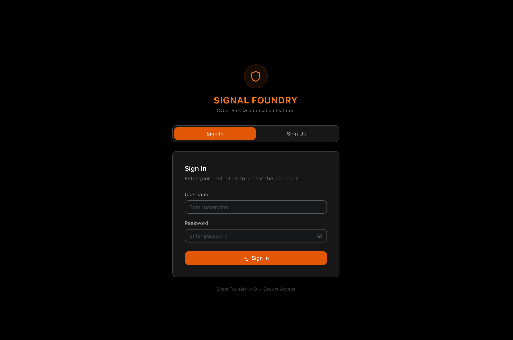

# SignalFoundry - Cyber Risk Quantification Platform

SignalFoundry connects to your Microsoft Sentinel SIEM and quantifies the financial impact of your security operations. It pulls resolved incidents, identifies true positives using MITRE ATT&CK validation, and calculates the actual cyber risk your security tools are preventing.



## How It Works

```
Your Security Tools (Defender, SentinelOne, CrowdStrike, Abnormal, etc.)
        |
        v
Microsoft Sentinel (your SIEM - aggregates everything)
        |
        v
SignalFoundry (pulls resolved incidents via Graph Security API)
        |
        v
True Positive Filter (MITRE ATT&CK validation + confidence scoring)
        |
        v
Risk Quantification (actual cost impact from validated threats)
        |
        v
Dashboard (ROI, net benefit, category breakdown, trends)
```

## Alert Categories

SignalFoundry maps alerts from 80+ security products into 5 categories:

| Category | Example Products |
|----------|-----------------|
| **EDR** | Defender for Endpoint, SentinelOne, CrowdStrike, Carbon Black, Cortex XDR |
| **Email** | Defender for Office 365, Abnormal Security, Proofpoint, Mimecast |
| **Network** | Azure Firewall, Palo Alto, Fortinet, Cisco, Darktrace |
| **Web** | Azure WAF, Cloudflare, Akamai, Imperva, F5 |
| **Cloud** | Defender for Cloud, AWS GuardDuty, Prisma Cloud, Wiz, Orca |

## Data Sources

Configure these under **Settings**. Each one pulls closed or resolved alerts every 15 minutes, with the analyst's verdict.

| Source | Kind | What it pulls | Credentials |
|--------|------|---------------|-------------|
| **Microsoft Sentinel** | Log source (SIEM) | Resolved incidents and their alerts, all categories | Azure AD app registration |
| **Splunk Enterprise Security** | Log source (SIEM) | Closed notable events (findings) with disposition, all categories | Management URL (port 8089) + authentication token |
| **CrowdStrike Falcon** | Direct tool | Closed alerts (endpoint, identity, cloud workload) | API client with `Alerts: Read` |
| **SentinelOne** | Direct tool | Resolved threats (endpoint) | Console URL + service-user API token |

A SIEM already aggregates your security tools, so connect one log source and leave the direct tool connections for tools that do **not** feed it. Connecting a tool both ways counts its alerts twice.

Connectors live in `src/lib/connectors/`. To add one, implement `ConnectorDefinition` (`types.ts`) and list it in `registry.ts`. `npm test` runs each connector against a local server that answers the way the vendor's documentation describes; none has been run against a live customer tenant yet.

## Quick Start

### 1. Install and run

```bash
cd signal-foundry
npm install
npm run dev
```

Open http://localhost:3000

### 2. Log in

On first launch, a default admin account is created with a **randomly generated password**. Find the credentials in:

```
.data/initial-credentials.txt
```

This file is created on the server — check it after first startup, log in, then **delete the file**.

For production, set the `AUTH_SECRET` environment variable:
```bash
# Generate a secure secret
openssl rand -base64 32
# Add to .env
AUTH_SECRET=your-generated-secret
```

If `AUTH_SECRET` is not set, a unique secret is auto-generated per installation and persisted to `.data/.auth-secret`. This is safe for development but in production you should set it explicitly in `.env`.

### 3. Configure (Settings page)

1. Enter your **Security Investment** amount (annual EDR/SOC/tooling spend)
2. Connect **Microsoft Sentinel**:
   - Create an Azure AD App Registration
   - Add API permissions: `SecurityIncident.Read.All`, `SecurityAlert.Read.All`, `User.Read.All`, `Device.Read.All`
   - Grant admin consent
   - Enter Tenant ID, Client ID, Client Secret in Settings
   - Click "Test Connection" to verify
   - Click "Save Settings" to start ingesting

### 4. Configure Email (Settings page, optional)

To enable email invitations for new users, configure SMTP in **Settings > Email / SMTP Configuration**:

| Provider | Host | Port |
|----------|------|------|
| Gmail | `smtp.gmail.com` | 587 |
| Outlook | `smtp.office365.com` | 587 |
| Amazon SES | `email-smtp.us-east-1.amazonaws.com` | 587 |

Without SMTP, user invites still work — the invite link is shown on-screen for manual sharing.

### 5. Invite Users (User Management in sidebar)

Admins invite users from **User Management** in the sidebar:
1. Click **"Invite User"** → enter email + role (Admin or Viewer)
2. User receives an email with an invite link (or admin copies the link manually)
3. User clicks the link, chooses their own username and password
4. Account activates — they appear in the user list with their role

New users can also self-register via the **Sign Up** tab on the login page (creates viewer accounts).

### 6. Data starts flowing

SignalFoundry polls Sentinel every 15 minutes for resolved incidents. Each incident's alerts are:
- Categorized by product name (EDR, Email, Network, Web, Cloud)
- Validated against MITRE ATT&CK techniques (200+ techniques, risk scoring)
- Filtered for true positives (MITRE + confidence, high severity, or high confidence)
- Cost impact summed from validated alerts

## Architecture

### System Architecture

```
┌──────────────────────────────────────────────────────────────────────────┐
│                         EXTERNAL SYSTEMS                                 │
│                                                                          │
│  ┌─────────────────┐    ┌─────────────────┐    ┌─────────────────────┐  │
│  │ Security Tools   │    │ Microsoft       │    │ Azure Active        │  │
│  │ (Defender, EDR,  │───▸│ Sentinel        │    │ Directory           │  │
│  │  Email, Network) │    │ (SIEM)          │    │ (User/Department)   │  │
│  └─────────────────┘    └────────┬────────┘    └──────────┬──────────┘  │
│                                  │                         │             │
└──────────────────────────────────┼─────────────────────────┼─────────────┘
                                   │                         │
                    ┌──────────────┼─────────────────────────┼──────────┐
                    │   SIGNALFOUNDRY SERVER                  │          │
                    │              │                          │          │
                    │   ┌──────────▼────────┐    ┌───────────▼───────┐  │
                    │   │ SentinelClient    │    │ DepartmentResolver│  │
                    │   │ (OAuth2 + Graph   │    │ (Azure AD lookup  │  │
                    │   │  Security API)    │    │  + 24h cache)     │  │
                    │   └──────────┬────────┘    └───────────────────┘  │
                    │              │                                     │
                    │   ┌──────────▼────────┐                           │
                    │   │ SentinelPoller    │ ◀── 15-min polling loop   │
                    │   │ (high-water mark, │     + on-demand sync      │
                    │   │  batch alerts)    │     + webhook receiver    │
                    │   └──────────┬────────┘                           │
                    │              │                                     │
                    │   ┌──────────▼────────────────────────────────┐   │
                    │   │ EDRDataService (Singleton)                │   │
                    │   │                                           │   │
                    │   │  ┌─────────────────────────────────────┐  │   │
                    │   │  │ In-Memory Alert Store               │  │   │
                    │   │  │ EDR | Email | Network | Web | Cloud │  │   │
                    │   │  └─────────────────────────────────────┘  │   │
                    │   │                                           │   │
                    │   │  • Sample data fallback (auto-replaced   │   │
                    │   │    when Sentinel connects)                │   │
                    │   │  • Deduplication by alert ID              │   │
                    │   │  • Timeframe filtering (quarterly)       │   │
                    │   │  • 5-min query cache                     │   │
                    │   └──────────┬────────────────────────────────┘   │
                    │              │                                     │
                    │   ┌──────────▼────────┐                           │
                    │   │ Cost Calculations │                           │
                    │   │                   │                           │
                    │   │ 1. True Positive  │ ◀── MITRE ATT&CK DB      │
                    │   │    Validation     │     (200+ techniques)     │
                    │   │ 2. Risk Scoring   │                           │
                    │   │ 3. Cost Benchmark │ ◀── Industry benchmarks   │
                    │   │    Lookup         │     (IBM, FBI, Ponemon)   │
                    │   │ 4. ROI Calc       │                           │
                    │   └──────────┬────────┘                           │
                    │              │                                     │
                    │   ┌──────────▼─────────────────────────────────┐  │
                    │   │ API Layer (Next.js API Routes)             │  │
                    │   │                                            │  │
                    │   │  /api/metrics     → Cost metrics + ROI     │  │
                    │   │  /api/edr-alerts  → Alert data + filters   │  │
                    │   │  /api/settings    → Config management      │  │
                    │   │  /api/sentinel/*  → SIEM control           │  │
                    │   │  /api/auth/*      → Login, users, RBAC     │  │
                    │   │                                            │  │
                    │   │  All routes protected by requireAuth()     │  │
                    │   └──────────┬─────────────────────────────────┘  │
                    │              │                                     │
                    │   ┌──────────▼────────┐                           │
                    │   │ Auth & Middleware  │                           │
                    │   │                   │                           │
                    │   │ • JWT sessions    │                           │
                    │   │ • RBAC (2 roles)  │                           │
                    │   │ • Rate limiting   │                           │
                    │   │ • File-backed     │                           │
                    │   │   user store      │                           │
                    │   └──────────┬────────┘                           │
                    └──────────────┼────────────────────────────────────┘
                                   │
                    ┌──────────────▼────────────────────────────────────┐
                    │   FRONTEND (React 19 / Next.js App Router)        │
                    │                                                    │
                    │  ┌──────────────────────────────────────────────┐  │
                    │  │ Login / Sign Up / Invite Accept               │  │
                    │  │ • First-run admin setup                       │  │
                    │  │ • Sign In / Sign Up tabs                      │  │
                    │  │ • /invite?token=xxx (set own password)        │  │
                    │  └──────────────────────────────────────────────┘  │
                    │                                                    │
                    │  ┌──────────────────────────────────────────────┐  │
                    │  │ Dashboard (role-aware sidebar navigation)    │  │
                    │  │                                              │  │
                    │  │  ┌─────────────┐  ┌──────────────────────┐  │  │
                    │  │  │ Executive   │  │ Trends & Analytics   │  │  │
                    │  │  │ Reports     │  │                      │  │  │
                    │  │  │             │  │ • Alert categories   │  │  │
                    │  │  │ • KPI cards │  │ • Quarterly trends   │  │  │
                    │  │  │ • Top depts │  │ • Severity dist.     │  │  │
                    │  │  │ • Cost data │  │ • KRI metrics        │  │  │
                    │  │  └─────────────┘  │ • PDF export         │  │  │
                    │  │                   └──────────────────────┘  │  │
                    │  │  ┌─────────────────┐  ┌─────────────────┐  │  │
                    │  │  │ User Management │  │ Settings        │  │  │
                    │  │  │ (admin only)    │  │                 │  │  │
                    │  │  │ • Invite users  │  │ • Investment    │  │  │
                    │  │  │ • Edit/delete   │  │ • Sentinel      │  │  │
                    │  │  │ • Role assign   │  │ • SMTP email    │  │  │
                    │  │  └─────────────────┘  └─────────────────┘  │  │
                    │  └──────────────────────────────────────────────┘  │
                    └───────────────────────────────────────────────────┘
```

### Data Flow: Sentinel → Dashboard

```
Sentinel Poller (every 15 min)
  → SentinelClient.getResolvedIncidentsWithAlerts()
    → OAuth2 token (cached, 60s buffer)
    → GET /security/incidents?$filter=status eq 'resolved'
    → GET /security/incidents/{id}/alerts (batches of 10)
  → DepartmentResolver (Azure AD user/device → department, 24h cache)
  → transformIncident()
    → mapProductToCategory() (80+ product keywords → 5 categories)
    → getIncidentCost() (benchmark lookup by category + severity)
  → EDRDataService.ingestAlerts() (deduplicate, store, invalidate cache)
  → Dashboard components query via getTimeframeAlerts()
  → CostCalculations pipeline validates true positives → ROI
```

### Sample Data Behavior

When Sentinel is not connected, the dashboard automatically loads sample data for demonstration purposes. This data is **not hardcoded** into the system — it is dynamically generated and **automatically cleared and replaced** the moment real Sentinel credentials are saved and the connection is established. No configuration needed.

### File Structure

```
src/
├── app/
│   ├── page.tsx                    # Main dashboard with sidebar navigation
│   ├── login/page.tsx              # Login + Sign Up screen
│   ├── invite/page.tsx             # Invite acceptance (set username + password)
│   ├── dashboard/                  # Executive summary + business units
│   ├── executive-reports/          # Detailed security tool metrics
│   ├── azure-sentinel-alerts/      # Alert browser with filtering
│   └── api/
│       ├── auth/
│       │   ├── login/              # POST - authenticate credentials
│       │   ├── logout/             # POST - clear session
│       │   ├── signup/             # POST - self-register as viewer
│       │   ├── me/                 # GET - current user + permissions
│       │   ├── setup/              # GET/POST - first-run admin creation
│       │   ├── invite/             # POST - admin sends invite (email + role)
│       │   ├── accept-invite/      # GET/POST - validate token, set password
│       │   └── users/              # CRUD - user management (admin only)
│       ├── settings/               # GET/POST platform settings (investment, Sentinel, SMTP)
│       ├── metrics/                # GET - cost metrics + ROI calculations
│       ├── sentinel/
│       │   ├── webhook/            # POST - receive pushed incidents
│       │   ├── status/             # GET - connection health + alert counts
│       │   ├── sync/               # POST - trigger manual pull
│       │   └── test/               # POST - test connection credentials
│       └── edr-alerts/             # GET - alert data with filtering
├── components/
│   ├── auth-provider.tsx           # React auth context + useAuth() hook
│   ├── trends-analytics.tsx        # Main analytics dashboard with PDF export
│   ├── user-management.tsx         # Invite users, edit/delete, role assignment
│   ├── settings-page.tsx           # Investment + Sentinel + SMTP config
│   └── dashboard/
│       ├── financial-metrics.tsx   # Cost savings, ROI, net benefit
│       └── business-units.tsx      # Top affected business units
├── lib/
│   ├── auth/                      # Authentication & RBAC system
│   │   ├── types.ts               # Role, User, Session, Permission types
│   │   ├── rbac.ts                # Permission map (admin/viewer)
│   │   ├── password.ts            # bcrypt hashing (12 salt rounds)
│   │   ├── jwt.ts                 # JWT sign/verify (jose, Edge-compatible)
│   │   ├── user-store.ts          # File-backed user store + invite tokens
│   │   ├── session.ts             # HttpOnly cookie session (8h expiry)
│   │   └── api-guard.ts           # requireAuth() wrapper for API routes
│   ├── email.ts                   # Nodemailer SMTP invite emails
│   ├── sentinel-client.ts         # Graph Security API client (OAuth2)
│   ├── sentinel-poller.ts         # Polling service (15min interval)
│   ├── sentinel-category-mapper.ts # Product name → category mapping (80+ products)
│   ├── sentinel-config.ts         # Sentinel credential config
│   ├── edr-data-service.ts        # Single source of truth + sample data fallback
│   ├── cost-calculations.ts       # True positive filter + MITRE (200+ techniques)
│   ├── cost-benchmarks.ts         # Industry benchmark cost matrix (IBM, FBI, Ponemon)
│   ├── department-resolver.ts     # Azure AD user/device → department (24h cache)
│   ├── settings-store.ts          # Persistent settings (investment, Sentinel, SMTP)
│   └── pdf-export.ts              # PDF report generation
├── data/
│   └── azure-sentinel-samples.ts  # Sample data generator (fallback only)
├── middleware.ts                   # Route protection (JWT verification)
└── types/
    └── alerts.ts                  # SecurityAlert + EDRQueryParams type definitions
```

## Key Calculations

The model lives in `src/lib/risk-model.ts`, the published data in `src/lib/anchor-data.ts`. Run `npm test` to check both.

The dollar figure is built top-down, so it cannot exceed what organisations of your size actually stand to lose:

```
exposure      = peer loss frequency / (1 - typical control effectiveness) x expected loss per event
loss avoided  = exposure x YOUR control effectiveness
ROI           = (loss avoided - investment for the period) / investment x 100
```

**1. Peer loss frequency and loss size (published).** From the Cyentia Institute's Information Risk Insights Study, by annual revenue band: the yearly probability of a loss event (IRIS 2022, Table 2; the geometric mean of Cyentia's lower and upper bounds) and the median and 95th-percentile loss per event (IRIS 2025). Expected loss per event caps each loss at the published 95th percentile. Set your revenue band under **Settings > Organisation profile**; until you do, $100M – $1B is assumed and the dashboard says so.

**2. Typical control effectiveness (assumed, 40%).** Published losses are the events that got past typical controls, so dividing by `1 - 0.4` gives the exposure with no detection and response. No study measures this quantity directly. The nearest evidence is Sophos' State of Ransomware (attacks stopped before encryption: 21%, 27% and 44% in 2023 to 2025) and Mandiant M-Trends (43–52% of intrusions detected internally). It is the model's most influential assumption, is held with a wide range, and can be changed in Settings (20–80%).

**3. Your control effectiveness (from your incidents).** Alerts are grouped into incidents. Each contained incident gets a seriousness weight:

```
weight = P(real) x stage weight

P(real):  analyst said truePositive -> 1;  falsePositive / benign -> 0 (excluded)
          no verdict: needs a known MITRE technique and tool confidence >= 70%
          (or confidence >= 90% without one), then weighted by that confidence
stage weight: by the furthest MITRE ATT&CK tactic seen, 0.02 (reconnaissance)
          to 0.75 (impact); falls back to severity when there is no tactic
```

```
effectiveness = (0.4 x 2 + sum of weights) / (2 + sum of weights + loss events you suffered)
```

With no incident data this equals the typical 40%. Contained incidents move it toward 100%; loss events you actually suffered (entered in Settings) pull it down. The stage weights are judgment-based defaults, but they now only decide where you sit between "typical" and "stopped everything" and how the total is shared between categories and departments. They cannot inflate the total.

**4. Range.** 5,000 seeded trials over the published frequency bounds and both effectiveness figures give a 5th–95th percentile range for the expected value. It is not a forecast of any single year.

**What the figures do not include.** The published data covers publicly known incidents and direct, quantifiable losses only, and is mostly from US organisations, so results err low. For many mid-sized organisations expected loss avoided will be smaller than security spend: in expected-value terms security behaves like insurance, and the dashboard also shows the chance of a material loss with and without your controls and the size of a severe event.

**Department Resolution (Top Affected Units):**

Departments are resolved automatically from your Azure AD — no manual mapping needed:

```
Alert evidence → userPrincipalName → GET /users/{upn}?$select=department → "Finance"
Alert evidence → deviceName → GET /devices → registeredOwners → user department → "IT"
No user/device → "Unattributed"
```

The resolver caches user→department mappings for 24 hours (departments rarely change). Batch lookups are used during polling to minimize API calls. Requires `User.Read.All` and `Device.Read.All` permissions.

## Authentication & RBAC

SignalFoundry uses JWT-based authentication with role-based access control. Sessions are stored as HttpOnly cookies (8-hour expiry).

### Roles

| Role | Permissions |
|------|-------------|
| **Administrator** | Full access: dashboard, reports, alerts, settings (edit), user management, Sentinel config |
| **Viewer** | Read-only: dashboard, reports, alerts, settings (view only, cannot edit) |

### User Invite Flow

1. Admin clicks **"Invite User"** in the **User Management** sidebar section
2. Enters the user's **email** and selects a **role** (Admin or Viewer)
3. System generates a secure invite token (72-hour expiry)
4. If SMTP is configured: an email with a branded invite link is sent
5. If no SMTP: the invite link is shown on-screen for manual sharing
6. User clicks the link → `/invite?token=xxx` → sets their own **username and password**
7. Account activates and user is auto-logged in

Users can also self-register via the **Sign Up** tab on the login page (creates viewer accounts).

Pending invites show a yellow "Pending" badge in the user list until accepted.

### Settings Page (3 sections)

| Section | Description |
|---------|-------------|
| **Security Investment** | Annual spend (EDR/SOC/tooling) for ROI calculations |
| **Microsoft Sentinel** | Tenant ID, Client ID, Client Secret for Graph API |
| **Email / SMTP** | Host, port, user, password, from address for invite emails |

All configurable from the UI. Viewers see settings read-only. SMTP can also be set via env vars.

## API Endpoints

### Authentication

| Method | Endpoint | Description | Auth |
|--------|----------|-------------|------|
| POST | `/api/auth/login` | Authenticate with username/password | Public |
| POST | `/api/auth/logout` | Clear session cookie | Public |
| POST | `/api/auth/signup` | Self-register as viewer | Public |
| GET | `/api/auth/me` | Get current user + permissions | Authenticated |
| GET | `/api/auth/setup` | Check if first-run setup needed | Public |
| POST | `/api/auth/setup` | Create first admin account | Public (only when no users exist) |
| POST | `/api/auth/invite` | Send invite (email + role) | Admin |
| GET | `/api/auth/accept-invite?token=` | Validate invite token | Public |
| POST | `/api/auth/accept-invite` | Accept invite (set username + password) | Public |
| GET | `/api/auth/users` | List all users | Admin |
| PUT | `/api/auth/users` | Update user | Admin |
| DELETE | `/api/auth/users?id=` | Delete user | Admin |

### Platform

| Method | Endpoint | Description | Required Permission |
|--------|----------|-------------|------|
| GET | `/api/settings` | Get platform settings (secrets masked) | `settings:view` |
| POST | `/api/settings` | Save investment amount + Sentinel credentials | `settings:edit` |
| GET | `/api/metrics` | Cost metrics, ROI, savings breakdown | `dashboard:view` |
| GET | `/api/edr-alerts` | Alert data with filtering | `alerts:view` |
| POST | `/api/sentinel/test` | Test Sentinel connection with credentials | `sentinel:configure` |
| GET | `/api/sentinel/status` | Connection health, polling state | `settings:view` |
| POST | `/api/sentinel/sync` | Trigger manual sync from Sentinel | `sentinel:sync` |
| POST | `/api/sentinel/webhook` | Receive pushed incidents (HMAC auth) | HMAC signature |

## Sentinel Webhook Setup (Optional)

For real-time ingestion (instead of waiting for the 15-min poll):

1. In Sentinel, create an Automation Rule triggered on incident status change to "Resolved"
2. Set action to call a Logic App
3. In the Logic App, POST the incident payload to `https://your-domain/api/sentinel/webhook`
4. Set the `x-sentinel-signature` header with HMAC-SHA256 of the body using your webhook secret

## Tech Stack

- **Framework**: Next.js 16, React 19, TypeScript, Tailwind CSS 4
- **UI**: Radix UI / Shadcn components, Lucide icons
- **Auth**: JWT (jose) + bcryptjs, HttpOnly cookies, RBAC (admin/viewer)
- **Email**: Nodemailer (any SMTP provider)
- **SIEM**: Microsoft Graph Security API (OAuth2 client_credentials)
- **Data**: Alerts are stored in a SQLite file (`.data/signalfoundry.db`, Node's built-in driver, needs Node 22.13+) and loaded into memory on startup, so history survives a restart. Settings and users are JSON files in `.data/`. Back up the `.data/` folder to back up everything

## Environment Variables

All settings below can also be configured from the **Settings** page in the UI (persisted to `.data/settings.json`).

```bash
# Authentication (required in production)
AUTH_SECRET=your-secure-random-secret    # openssl rand -base64 32

# Sentinel connection (or configure via Settings UI)
SENTINEL_TENANT_ID=your-azure-ad-tenant-id
SENTINEL_CLIENT_ID=your-app-registration-client-id
SENTINEL_CLIENT_SECRET=your-client-secret
SENTINEL_WORKSPACE_ID=your-log-analytics-workspace-id     # optional
SENTINEL_POLLING_INTERVAL=900000                           # optional, default 15min
SENTINEL_WEBHOOK_SECRET=your-hmac-secret                   # optional

# SMTP for email invitations (or configure via Settings UI)
SMTP_HOST=smtp.gmail.com
SMTP_PORT=587
SMTP_USER=your-email@gmail.com
SMTP_PASS=your-app-password
SMTP_FROM="SignalFoundry <noreply@yourcompany.com>"        # optional

# Override login URL in invite emails (useful behind reverse proxy)
APP_URL=https://signalfoundry.yourcompany.com              # optional
```

## License

MIT
